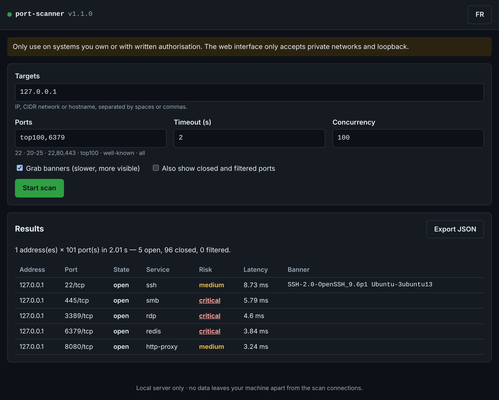

# port-scanner

[](https://github.com/Aiyeesha/port-scanner/actions/workflows/tests.yml)


🇫🇷 [Version française](README.fr.md)

An **asynchronous**, **secure-by-default** TCP port scanner that does more than list open ports:
it reports the likely **service**, its **risk level** and the **defensive measure** to apply.
A **detection side** (Blue Team) then shows how to spot such a scan in network traffic.

> The tool's human-readable output is in French; the JSON and CSV formats use stable English keys.

---

## ⚖️ Legal notice — read before use

Only use this tool on machines and networks you own, or for which you hold the owner's
**written authorisation**.

Unauthorised scanning may be unlawful depending on your jurisdiction (in France, articles 323-1
and 323-3-1 of the Penal Code cover unauthorised access to information systems and possession of
tools designed for it without a legitimate reason) and usually breaches your ISP's or cloud
provider's terms of service.

This is why the tool **refuses by default** any target that is neither private nor loopback.

---

## Features

- **Asynchronous TCP connect scan** (asyncio): hundreds of concurrent probes in a single thread.
- **Three states**: open, closed, filtered — with per-response latency.
- **~50 service profiles**: name, risk level (info → critical) and defensive recommendation.
- Optional, passive, **sanitised banner grabbing** (no terminal injection possible).
- **Outputs**: coloured table, stable **JSON** and **CSV** for scripts and SIEMs.
- **CI-friendly**: `--fail-on high` exits with code 1 when a risky port is open.
- **Safeguards**: private networks only by default; size, duration and concurrency caps.
- **Local web UI** (`port-scanner-web`): same engine, reachable from your own machine only.
- **Zero dependencies**: Python standard library only.

---

## Installation

Requirements: **Python 3.11+** and **Git**.

```powershell
# Windows (PowerShell)
git clone https://github.com/Aiyeesha/port-scanner.git
cd port-scanner
python -m venv .venv
.\.venv\Scripts\Activate.ps1
pip install .
port-scanner --version
```

```bash
# Linux / macOS
git clone https://github.com/Aiyeesha/port-scanner.git
cd port-scanner
python3 -m venv .venv
source .venv/bin/activate
pip install .
port-scanner --version
```

---

## Usage

```powershell
port-scanner 127.0.0.1                          # top 100 ports on your own machine
port-scanner 192.168.1.0/24 -p 22,80,443        # three ports across a home network
port-scanner nas.local -p well-known --banners  # system ports plus banners
port-scanner 10.0.0.5 -f json -o scan.json      # JSON report written to a file
port-scanner 10.0.0.5 --fail-on high            # exit 1 if a high/critical service is exposed
```

| Targets | Example |
|---|---|
| IPv4 / IPv6 address | `192.168.1.10`, `::1` |
| CIDR network | `192.168.1.0/24` (network and broadcast addresses excluded) |
| Hostname | `nas.local` (**every** resolved address goes through the safeguard) |

| Ports | Example |
|---|---|
| Single / range / list | `22`, `20-25`, `22,80,443` |
| Preset | `top100` (default), `well-known` (1–1023), `all` (1–65535) |

| Option | Default | Purpose |
|---|---|---|
| `-p`, `--ports` | `top100` | ports to scan |
| `-t`, `--timeout` | `1.0` | per-probe timeout in seconds (max 30) |
| `-c`, `--concurrency` | `100` | concurrent probes (1–500) |
| `--max-hosts` | `1024` | maximum number of addresses (max 65,536) |
| `--banners` | off | read banners from open ports |
| `--banner-timeout` | `2.0` | banner read timeout (max 10 s) |
| `--allow-public` | off | allow non-private targets (written authorisation only) |
| `-f`, `--format` | `text` | `text`, `json` or `csv` |
| `-o`, `--output` | stdout | output file (never overwritten without `--force`) |
| `--all` | off | include closed and filtered ports |
| `--fail-on` | off | `info`, `low`, `medium`, `high` or `critical` |
| `--no-color` | | disable colours (`NO_COLOR` is honoured too) |
| `-q`, `--quiet` | | no progress, no warnings |

| Exit code | Meaning |
|---|---|
| `0` | scan completed (and `--fail-on` threshold not reached) |
| `1` | at least one open port reaches the `--fail-on` threshold |
| `2` | input error, or target refused by the safeguard |
| `3` | runtime error (output file cannot be written…) |
| `130` | interrupted (Ctrl+C) |

JSON output (keys and values stable since v1.0.0):

```json
{
  "tool": "port-scanner", "version": "1.0.0",
  "started_at": "2026-11-04T20:00:00+00:00", "duration_s": 2.08,
  "targets": 1, "ports_per_target": 100,
  "settings": { "ports": "top100", "timeout_s": 1.0, "concurrency": 100, "banners": false, "allow_public": false },
  "summary": { "open": 2, "closed": 98, "filtered": 0 },
  "results": [
    { "address": "127.0.0.1", "source": "127.0.0.1", "port": 445, "state": "open",
      "service": "smb", "risk": "critical", "latency_ms": 1.2, "banner": null, "error": null }
  ]
}
```

---

## How it works

For each (address, port) pair, the tool opens a **real TCP connection** (full SYN → SYN/ACK → ACK
handshake) and closes it immediately: accepted → **open**; refused (RST) → **closed**; no answer
before the timeout → **filtered**.

This mode needs **no administrator rights** (unlike Nmap's SYN scan) but is more **visible**: each
connection may be logged by the target service — which the detection side builds on.

> ℹ️ **Windows quirk**: on loopback, Windows retries a refused connection for about 2 seconds. With a
> shorter timeout, a closed port on `127.0.0.1` may show as "filtered". Use `-t 3` on your own machine.

## Local web UI

```powershell
port-scanner-web                 # opens the browser on http://127.0.0.1:8765/#token=…
port-scanner-web --port 0        # let the OS pick a port
port-scanner-web --no-browser    # only print the link
```



The UI drives the same engine as the CLI and returns the same (exportable) JSON document. It is
deliberately **stricter** than the CLI: the private-network safeguard cannot be lifted from it.

A "local" server is still reachable by any page open in your browser, so it is protected like an
exposed service:

| Threat | Mitigation |
|---|---|
| Access from the network | binds to `127.0.0.1` or `::1` only; any other address is refused |
| Third-party site sending requests (CSRF) | random 256-bit token regenerated at each launch, required in the `X-Scan-Token` header; `Origin` check; no CORS grant |
| DNS rebinding | `Host` header must be `127.0.0.1:PORT`, `localhost:PORT` or `[::1]:PORT` |
| Token leakage | passed in the URL **fragment** (`#token=`), never sent to the server or in the Referer, then removed from the address bar; constant-time comparison |
| Page injection (XSS) | strict CSP with no inline script; results rendered with `textContent`, never `innerHTML` |
| Resource abuse | 4 KiB JSON body, 32 targets per request, one scan at a time (`409`) |
| Information leakage | generic error responses, `Server` header without Python version, `Cache-Control: no-store` |

## Secure design

| Risk | Mitigation |
|---|---|
| Scanning a third-party network by mistake | private (RFC 1918, IPv6 ULA) and loopback targets only by default |
| Bypassing the safeguard | IPv4-mapped IPv6 normalised; **all** DNS answers checked; shorthand IPs (`127.1`, `0x7f.1`) rejected |
| Typo launching a huge scan | 1,024-address cap checked **before** enumeration; 262,144 probes max |
| Exhausting local or network resources | bounded concurrency (500) and timeout (30 s) |
| Leaked sockets | connections closed in `finally`; tests run in dev mode with warnings as errors |
| Malicious banners (terminal escapes, Trojan Source) | non-printable characters escaped; bounded read size and time |
| CSV formula injection | cells starting with `= + - @` prefixed with an apostrophe (OWASP) |
| Overwriting an existing report | exclusive file creation, `--force` required |
| Supply chain | no runtime dependencies; Dependabot and Ruff (Bandit rules) in CI |

## Detection side (Blue Team)

The [`detection/`](detection/README.en.md) folder shows how to **spot** such a scan: annotated Wireshark
captures, two **Suricata** rules and a **Sigma** correlation rule, all automatically verified in CI
against real captures (MITRE ATT&CK T1046).

## Limitations

- **TCP only** — no UDP scanning.
- **Service names are inferred from port numbers**; banners help confirm them.
- **No OS or version detection** beyond banners.
- **No evasion techniques** — this is a defence-oriented learning tool.

## Development

```powershell
pip install -e ".[dev]"
python -X dev -m pytest -v
ruff check .
ruff format .
```

Tests **never** reach the outside network: real states are tested on `127.0.0.1` / `::1`, the rest is simulated.

## Roadmap

| Step | Content | Status |
|---|---|---|
| 1 | Repository, layout, continuous integration | ✅ |
| 2 | Target and port parsing, private-network safeguard | ✅ |
| 3 | Asynchronous TCP connect scan (asyncio), bounded concurrency | ✅ |
| 4 | Service identification, risk level, optional banner grabbing | ✅ |
| 5 | Full CLI, JSON/CSV output, exit codes | ✅ |
| 6 | Tests against local servers, docs, hardening → **v1.0.0** | ✅ |
| 7 | Detection side: Wireshark capture, Suricata rule and Sigma rule | ✅ |
| 8 | Local web UI → **v1.1.0** | ✅ |

## License

[MIT](LICENSE) © Aïcha Imène Dahoumane
